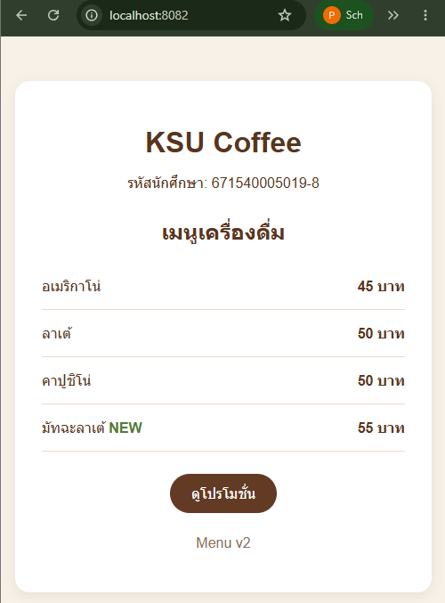
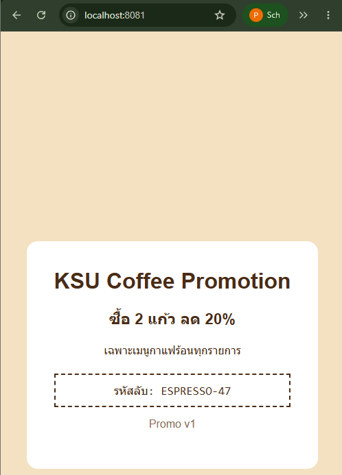

# ANSWER — Pattharaprapha Wongmueangklang 671540005019-8

## Part A — ข้อมูลจาก image kamthornsa/ksu-promo:1.0

| คำถาม | คำตอบ | คำสั่งที่ใช้ |
| --- | --- | --- |
| Port | 3000 และ 80 (ตามผล inspect) | docker image inspect kamthornsa/ksu-promo:1.0 --format '{{json .Config.ExposedPorts}}' |
| CMD | เติมผลตรวจจริง | docker image inspect kamthornsa/ksu-promo:1.0 --format '{{json .Config.Cmd}}' |
| Base image | เติมผลตรวจจริง | docker history --no-trunc kamthornsa/ksu-promo:1.0 |

## Part B — รหัสลับบนหน้าโปรโมชั่น

ESPRESSO-47 

## Part C — คำถาม

1. แก้ข้อความหน้าโปรโมชั่นไม่ได้ เพราะไม่มีซอร์สโค้ดของ image ให้แก้ ส่วนหน้าเมนูเป็นไฟล์ HTML ของเราเอง จึงแก้ไขและ build ใหม่ได้

2. ต้องทดลอง pull image ที่ไม่ระบุ tag แล้วเปิดตรวจหน้าเว็บจริง จึงจะตอบได้ว่าหน้าเว็บเป็นแบบใด เพราะ Docker จะใช้ tag `latest` โดยปริยาย แต่ผลขึ้นอยู่กับ image ที่มีอยู่จริง

3. ตัวเลขซ้ายของ `:` คือพอร์ตบนเครื่องเรา ส่วนขวาคือพอร์ตใน container หน้าโปรโมชั่นใช้พอร์ตภายใน 3000 ตามผลตรวจ image จึงใช้ `8081:3000`

4. ถ้าแก้ HTML แล้วสั่ง `docker compose up -d` อย่างเดียว image เดิมอาจยังถูกใช้ ต้องสั่ง `docker compose up -d --build menu` เพื่อ build และอัปเดตเฉพาะหน้าเมนู

5. ใช้ `http://localhost:8081` เพราะเป็น URL ที่เบราว์เซอร์บนเครื่องเราเข้าถึงได้ ส่วน `http://promo:3000` ใช้เรียก service name ภายในเครือข่าย Compose ไม่ใช่ชื่อโฮสต์ที่เบราว์เซอร์บนเครื่องเราเข้าถึงโดยตรง

## ภาพหน้าจอ

